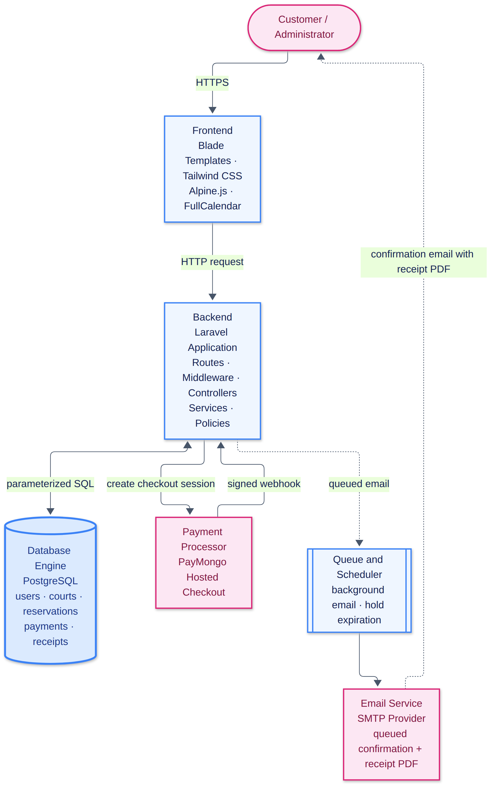
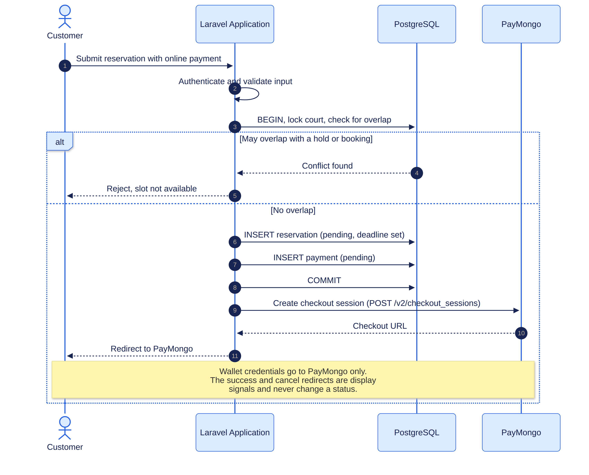
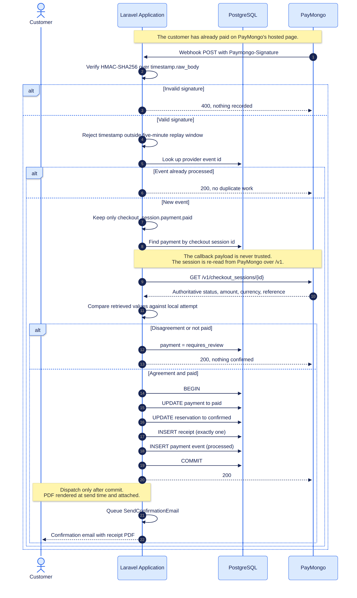
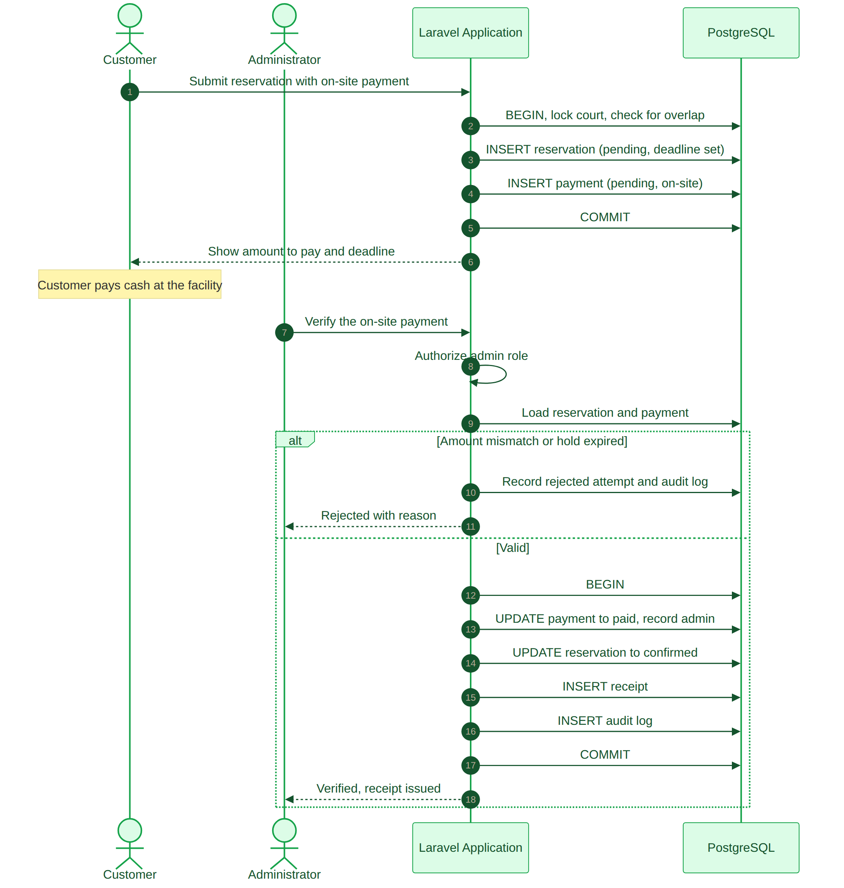

# PRIVATE PICKLEBALL COURT RESERVATION SYSTEM LOCATED IN SAN JOSE, PUERTO PRINCESA CITY, PALAWAN

**Technical Documentation and System Integration Paper**

**Project Title:** Private Pickleball Court Reservation System Located in San Jose, Puerto Princesa City, Palawan

**Course:** BSIT

**Prepared by:**

Ariel James Adesir

Fea Bulanay

Johnruzzel Correa

Jerome Gatila

Jenny Benosa

**Instructor:** Toni Rose Correa

October 27, 2026

# Chapter 1 — Introduction

## 1.1 Project Overview

The Private Pickleball Court Reservation System is a web application that allows customers to reserve a pickleball court at a privately operated pickleball facility in Barangay San Jose, Puerto Princesa City, Palawan. The system provides an availability calendar that reports the status of each pickleball court for a selected date and time, accepts a booking with a chosen court, start time, and duration, and completes the reservation through either online or on-site payment.

**Scope.** This project is limited to reserving pickleball courts. Every use of "court" in the following requirements, workflows, database design, and reports refers to a pickleball court; the system does not manage bookings for multiple sports.

The distinguishing requirement is integrity rather than convenience. A court cannot be rented twice in the same time window, a payment must not confirm a booking that overlaps another, and no customer may read another customer's record. These are not interface concerns; they are correctness concerns, and the design of this system is shaped by them.

The system was built as a monolithic Laravel application on a PostgreSQL database. Online payment is integrated with PayMongo, whose hosted checkout page receives all payment credentials so that no card or wallet data ever reaches this application. Confirmation is not taken from the browser: the customer's success redirect is treated only as a display signal, and a booking is confirmed exclusively after PayMongo's own server-to-server webhook has been cryptographically verified and the transaction has been independently retrieved and compared against the local payment attempt. Every confirmed payment produces one immutable receipt, rendered as a PDF and downloadable by its owner.

## 1.2 Problem Statement

Manual reservation at a private pickleball facility depends on the customer visiting the site or contacting an administrator. This produces three recurring failures.

First, **double booking.** Availability is determined from memory or a paper list. Two customers requesting the same court and time can both be told the court is free. Neither party discovers the error until one arrives to find the court occupied, and the resolution depends on the administrator's discretion rather than a rule.

Second, **delayed and unverifiable confirmation.** A customer who sends payment has no reliable proof that the booking was recorded. Records may exist only on paper, and the customer has no document to produce when arriving. This is especially costly for customers without mobile load, who cannot cheaply confirm a transaction or retrieve a receipt at the last minute.

Third, **inconsistent records.** Reservations, cancellations, schedules, and payments are maintained separately or not at all. The facility cannot answer how much was collected in a period, which pickleball court is underused, or whether a payment was verified, because the underlying records are not consistently captured.

The system replaces these informal processes with a centralized database, a server-authoritative availability calculation, database-level protection against overlapping bookings, and a verifiable payment record attached to every confirmed reservation.

## 1.3 Project Objectives

**General objective.** To develop a reliable Private Pickleball Court Reservation System that prevents conflicting reservations, verifies payments before confirming a booking, and produces durable proof of every transaction, while giving administrators a centralized view of pickleball courts, schedules, reservations, and payments.

**Specific objectives.**

1. Provide an availability calendar reporting each pickleball court as Available, Pending, or Reserved for a given date and time.
2. Allow a customer to reserve a pickleball court by selecting date, start time, and duration, and **prevent double reservations at the database level**, not only in application code.
3. Provide online and on-site payment options, confirming a reservation **only** after payment has been independently verified.
4. Detect forged, replayed, and duplicated payment callbacks and refuse to change state on any of them.
5. Send a confirmation email containing payment and receipt details through a background queue, so that email latency never blocks the booking flow.
6. Provide a downloadable PDF receipt immediately after payment and re-downloadable from reservation history.
7. Enforce role-based authorization so that customers see only their own records and only administrators reach administrative pages.
8. Provide administrators with filtered reservation and collected-payment reports.

---

# Chapter 2 — System Analysis and Requirements Specification

## 2.1 Functional Requirements

### FR-1 User Registration and Login

| ID | Requirement |
|---|---|
| FR-1.1 | A visitor must be able to create an account and register. |
| FR-1.2 | A registered user must authenticate before reserving a pickleball court. |
| FR-1.3 | Newly registered accounts must always be created with the `customer` role. The administrator role must never be selectable during registration. |

### FR-2 Availability Calendar

| ID | Requirement |
|---|---|
| FR-2.1 | The system must display, for a selected pickleball court and date, the status of every bookable slot as Available, Pending, or Reserved. |
| FR-2.2 | Slot reporting must exclude holds whose payment deadline has already passed, even if the scheduled expiration task has not yet run. |

### FR-3 Pickleball Court and Schedule Selection

| ID | Requirement |
|---|---|
| FR-3.1 | A customer must be able to select a pickleball court, a date, a start time, and a duration. |
| FR-3.2 | The system must reject any reservation that overlaps an existing Pending or Confirmed reservation on the same pickleball court. |
| FR-3.3 | Adjacent reservations must be accepted: a booking ending at 11:00 must not block a booking beginning at 11:00. |
| FR-3.4 | The booked hourly rate and the computed total must be stored on the reservation so that later rate changes cannot alter an existing booking. |

### FR-4 Payment System and Method Selection

| ID | Requirement |
|---|---|
| FR-4.1 | A customer must be able to select Online or On-site payment. |
| FR-4.2 | For online payment, the reservation must be confirmed **only** after PayMongo's webhook has been signature-verified and the transaction independently retrieved. |
| FR-4.3 | For on-site payment, the schedule must be held as Pending and released automatically if unpaid within the payment period. |
| FR-4.4 | Only an administrator may mark an on-site payment verified. |
| FR-4.5 | The browser success and cancel redirects must never change a reservation or payment status. |

### FR-5 Receipt and Email Confirmation

| ID | Requirement |
|---|---|
| FR-5.1 | The system must generate a downloadable PDF receipt immediately after verified payment. |
| FR-5.2 | The receipt must contain the receipt number, reservation reference, customer name and email, court name and location, reservation date, start and end time, duration, payment method, payment status, amount paid, and transaction date. |
| FR-5.3 | Exactly one receipt must exist per verified payment, regardless of how many callbacks arrive. |
| FR-5.4 | The receipt must remain downloadable from reservation history even if the email delivery fails. |
| FR-5.5 | No receipt may be generated for a Pending, Cancelled, or Expired reservation. |
| FR-5.6 | A customer must not be able to download another customer's receipt. |
| FR-5.7 | The receipt must be an immutable snapshot; later edits to a court or rate must not rewrite an issued receipt. |

### FR-6 Reservation Status and History

| ID | Requirement |
|---|---|
| FR-6.1 | A customer must be able to view the status and history of their own reservations. |
| FR-6.2 | A customer must be able to re-download the receipt of a paid reservation. |

### FR-7 Pickleball Court Management

| ID | Requirement |
|---|---|
| FR-7.1 | An administrator must be able to create, view, update, and archive pickleball courts, including court name or number, location, rate, image, and active status. |
| FR-7.2 | A deletion must require an explicit confirmation step. |
| FR-7.3 | A pickleball court that already has reservations must be archived (soft-deleted) rather than destroyed, so that historical records remain valid. An unused pickleball court may be deleted permanently. |
| FR-7.4 | An administrator must be able to block a pickleball court interval for maintenance, repair, or a private event, and remove such a block. |

### FR-8 Reservation and Payment Monitoring

| ID | Requirement |
|---|---|
| FR-8.1 | An administrator must be able to filter and open reservation records. |
| FR-8.2 | An administrator must be able to review the method, amount, date, and status of each payment attempt. |
| FR-8.3 | An administrator must be able to verify or reject a pending on-site payment, and rejection must require a recorded reason. |

### FR-9 Reports

| ID | Requirement |
|---|---|
| FR-9.1 | The system must generate reservation and collected-payment reports filterable by date range, pickleball court, and status. |
| FR-9.2 | Collected-payment totals must count only verified paid payments. Pending, failed, cancelled, and duplicate attempts must not inflate revenue. |

## 2.2 Non-Functional Requirements

**Security.** Access is enforced server-side. Every protected route requires an authenticated session and a role check; hiding a link is never treated as authorization. Customers can reach only their own reservations and receipts. Passwords are stored only as hashes. Raw webhook payloads are never persisted because they may contain billing details. API secrets live in environment variables and are never committed.

**Data integrity.** This is the central non-functional requirement. A reservation may never overlap another blocking reservation on the same court, and this must hold under concurrent requests, not merely sequential ones. A payment must never be counted twice, and a late payment must never reclaim a slot that has already been released.

**Data validation.** All writes pass through server-side validation objects. Durations, times, dates, and amounts are rejected server-side regardless of what the browser submitted. Money is handled as decimal values in units of currency, never as floating-point arithmetic.

**Performance.** Availability is computed by a single authoritative service rather than reimplemented per controller, and list views eager-load their relations so that rendering a page does not issue a query per row.

**Usability and maintainability.** The interface uses plain server-rendered HTML forms with clearly labelled inputs and field-level validation, consistent with the functional emphasis of the assignment. Controllers coordinate requests and delegate business workflows to named actions and services.

## 2.3 System Use Cases

**Actors:** Customer, Administrator, Payment Provider (PayMongo), Email Service.

| Use Case | ID | Sub-ID | Description |
|---|---|---|---|
| Register and log in | SUC-1 | SUC-1.1 | A customer creates an account, always with the customer role. |
| | | SUC-1.2 | A registered user authenticates before reserving. |
| View pickleball court availability | SUC-2 | SUC-2.1 | A customer views the pickleball availability calendar instead of visiting the facility. |
| | | SUC-2.2 | The system reports each slot as Available, Pending, or Reserved. |
| Reserve pickleball court | SUC-3 | SUC-3.1 | A customer chooses a pickleball court, date, start time, and duration. |
| | | SUC-3.2 | The system rejects any reservation overlapping a blocking reservation, at the application layer and again at the database layer. |
| Make payment | SUC-4 | SUC-4.1 | A customer selects online or on-site payment. |
| | | SUC-4.2 | For online payment, PayMongo hosts the checkout and the reservation is confirmed only after verification. |
| | | SUC-4.3 | For on-site payment, the slot is held and released if unpaid before the deadline. |
| Receive and download receipt | SUC-5 | SUC-5.1 | A customer receives proof of reservation that can be saved offline. |
| | | SUC-5.2 | The system emails the confirmation and links to the PDF receipt. |
| | | SUC-5.3 | The receipt stays downloadable in reservation history, and one customer cannot open another's receipt. |
| View status and history | SUC-6 | SUC-6.1 | A customer tracks reservation status. |
| | | SUC-6.2 | A customer re-downloads receipts of paid reservations. |
| Verify online payment | SUC-7 | SUC-7.1 | PayMongo sends a signed callback. |
| | | SUC-7.2 | The system verifies the signature and retrieves the transaction before confirming. |
| Manage pickleball courts | SUC-8 | SUC-8.1 | An administrator creates, edits, and archives pickleball courts. |
| | | SUC-8.2 | An administrator blocks pickleball court intervals for maintenance or private events. |
| Monitor reservations | SUC-9 | SUC-9.1 | An administrator filters and opens reservation records. |
| Verify payments | SUC-10 | SUC-10.1 | An administrator verifies on-site payment, producing one receipt and one email. |
| | | SUC-10.2 | Rejection requires a reason and is recorded in the audit log. |
| Generate reports | SUC-11 | SUC-11.1 | The system reports reservations and collected payments from verified stored data only. |

---

# Chapter 3 — Architecture and System Design

## 3.1 Technical Stack Justification

The instructor's specification requires that the chosen technologies be **justified**, not prescribed. The selection below is argued on the property each technology contributes to the requirements in Chapter 2.

| Layer | Technology | Version | Rationale |
|---|---|---|---|
| Backend language | PHP | 8.3.6 | Mature, widely deployed, and supported by the payment and PDF libraries chosen below. |
| Backend framework | Laravel | 13.37.0 | Provides the transaction boundaries, queueing, scheduler, and policy-based authorization the design depends on, without requiring additional infrastructure such as Redis. |
| Database | PostgreSQL | 16.15 | The decisive choice. PostgreSQL supports declarative exclusion constraints, which allows double-booking to be prevented **by the database itself** rather than by application code. See §4.2. |
| Query layer | Eloquent ORM | bundled | Parameterized queries by default, so user input is never concatenated into SQL. |
| Templating | Blade | bundled | Server-side rendering with automatic output escaping, addressing cross-site scripting without per-field discipline. |
| Payment provider | PayMongo Checkout Sessions API | v1 | A gateway used by Philippine merchants. Its hosted checkout page receives card and wallet credentials so that this application never handles them, and it signs webhook callbacks with HMAC-SHA256, enabling cryptographic verification rather than trust. |
| Email | Laravel Mail (SMTP) | bundled | Standard protocol. Configured with a Mailtrap transport and a log-driver fallback so that a mail outage degrades to a visible log entry instead of a failed job. |
| PDF generation | barryvdh/laravel-dompdf | 3.1.6 | Pure PHP; requires no system binary or headless browser, so receipt generation cannot fail for environmental reasons on the deployment host. |
| Queue | Laravel queue, `database` driver | bundled | Satisfies the asynchronous email requirement with no additional service. |
| Scheduler | Laravel Scheduler | bundled | Runs hold expiration every minute without an external cron daemon. |
| Testing | PHPUnit | 12.5.40 | Automated verification of the business rules in Chapter 5. |

**Why PostgreSQL was chosen over MySQL.** The requirement that two reservations cannot overlap under concurrent requests cannot be satisfied by application validation alone. Two simultaneous requests can both read "available" before either writes, so both pass validation and both insert. Resolving this requires a database mechanism that decides atomically. PostgreSQL's `EXCLUDE USING gist` constraint makes the second insert fail regardless of application behaviour. This single capability is the reason for the database choice, and it is examined in §4.2.

**Why PayMongo.** Three properties were required: that the customer can complete payment without the merchant handling credentials, that the callback can be cryptographically authenticated, and that the payment can be independently verified server-to-server. PayMongo's hosted checkout satisfies the first, signed webhooks satisfy the second, and its secret-key transaction retrieval endpoint satisfies the third.

## 3.2 Architectural Block Diagram



**Design notes.**

- **One confirmation path.** Both the PayMongo webhook and administrator on-site verification call `ConfirmPayment`. Two implementations could drift; one action cannot.
- **The gateway is an interface.** `PaymentGateway` defines the contract, and `PayMongoGateway` implements it. Business logic depends on the interface, so the provider is replaceable without touching reservation, receipt, or reporting logic.
- **Controllers are thin.** They authorize, validate, delegate, and redirect. Multi-record state transitions live in actions wrapped in database transactions.

## 3.3 Sequence Diagrams

### 3.3.1 Payment Checkout



The browser redirect in the middle of this flow changes nothing about the reservation's state. It moves the customer to PayMongo so that wallet credentials never touch this application, but the booking is held Pending until the webhook in the following section confirms the money.

### 3.3.2 Webhook Processing



The callback is verified twice. The signature proves the message came from PayMongo and was not replayed; the independent retrieval of the checkout session proves that the transaction genuinely settled at the expected amount and currency. Neither check trusts the payload, and a correctly signed callback that reports an unsettled transaction confirms nothing.

### 3.3.3 On-Site Payment Verification



---

# Chapter 4 — Implementation Details

## 4.1 CRUD and Business Logic Module

### 4.1.1 Create

Reservation creation is the system's most consequential write, so it is implemented as a single named action, `CreateReservation`, rather than in a controller. The action executes inside a database transaction and, in order:

1. Verifies the selected pickleball court exists, is active, and is not archived.
2. Re-derives the total from the court rate and the requested duration on the server, ignoring any total submitted by the client.
3. Copies the current hourly rate onto the reservation row so the booking is insulated from later price changes.
4. Re-checks availability inside the transaction rather than trusting the earlier calendar query, which may be stale by the time the request arrives.
5. Inserts the reservation with a unique human-readable reference number and a payment deadline derived from the selected method.
6. Inserts the initial Pending payment attempt in the same transaction, so a reservation can never exist without its payment record.

Reference numbers are generated as a prefix, a date, and random characters, and the column carries a unique index. A collision is therefore detected by the database rather than producing two identical references.

### 4.1.2 Read

Availability is computed by one class, `AvailabilityService`, which is the single authority for slot logic. Controllers and views do not reimplement its rules. It treats intervals as **half-open**, written `[starts_at, ends_at)`: two intervals overlap when and only when `existing.start < requested.end` **and** `existing.end > requested.start`. A reservation ending at 11:00 therefore does not conflict with one beginning at 11:00.

A slot is blocked by an active Pending hold, a Confirmed reservation, a Completed reservation, or an administrative pickleball court block. Expired and Cancelled reservations do not block. Because the scheduled sweeper may be delayed, the service also treats a Pending hold whose deadline has passed as expired when computing availability, so a stale row never keeps a court falsely occupied.

The customer history page and reservation detail view eager-load their relations, so rendering twenty reservations performs a fixed number of queries rather than one per row.

### 4.1.3 Update

Pickleball court editing uses a prepopulated form and a dedicated validation object. Uniqueness validation excludes the court's own identifier, so saving a pickleball court without renaming it does not fail against itself. Reservation transitions are not edited as arbitrary fields: only permitted transitions are exposed, and each records a reason where the change is consequential.

### 4.1.4 Delete

Deletion requires an explicit confirmation step. A pickleball court that already has reservations is **archived** rather than destroyed, because historical reservations must continue to reference it and because destroying the record would invalidate issued receipts. An unused pickleball court may be deleted permanently. Archiving and restoring are both recorded in the audit log.

### 4.1.5 Business Rules

All booking rules are declared in `config/reservation.php` rather than scattered through controllers and views.

| Rule | Value |
|---|---|
| Facility timezone | `Asia/Manila` |
| Currency | `PHP` |
| Operating hours | 09:00 – 21:00 |
| Closed days | Sunday |
| Booking increment | 30 minutes |
| Minimum duration | 60 minutes |
| Maximum duration | 240 minutes |
| Advance booking window | 30 days |
| Lead time before start | 60 minutes |
| Online payment hold | 15 minutes |
| On-site payment hold | 1440 minutes (24 hours) |

The on-site hold is longer than the online hold because the customer must physically reach the facility, but a hold is never permitted to extend past the reservation's own start time.

## 4.2 Database Connectivity

The application connects to PostgreSQL through Laravel's database layer with parameterized queries. User input is bound, never concatenated, which is the primary defence against SQL injection.

### 4.2.1 Database-Level Double-Booking Prevention

This is the most significant design decision in the system.

Application validation alone cannot prevent a race. Two concurrent requests can both read "available" before either writes; both pass validation; both insert. A unique index cannot express "these two rows must not overlap," because overlap is a relation between two columns, not a single value.

PostgreSQL's `EXCLUDE USING gist` constraint expresses exactly this. Applied to the reservations table:

```sql
ALTER TABLE reservations
    ADD CONSTRAINT reservations_no_overlapping_holds
    EXCLUDE USING gist (
        court_id WITH =,
        tstzrange(starts_at, ends_at, '[)') WITH &&
    )
    WHERE (status IN ('pending', 'confirmed', 'completed'));
```

Read piece by piece:

- `court_id WITH =` — the constraint applies within a single pickleball court; two different pickleball courts may hold the same interval.
- `tstzrange(starts_at, ends_at, '[)') WITH &&` — the two timestamp columns are combined into a range and tested for overlap. The `'[)'` bound is what encodes the half-open rule: the start is inclusive and the end exclusive, which is precisely why adjacent bookings are permitted.
- `WHERE (status IN (...))` — the constraint is **partial**. Only blocking statuses participate, so a Cancelled or Expired reservation can sit on top of an interval without conflicting.

The consequence is that correctness does not depend on application behaviour. Any code path — a controller, a console command, a future admin tool, or a raw `INSERT` typed by hand — is subject to the same rule. The test `test_the_database_rejects_a_directly_inserted_overlap` inserts an overlapping row directly through the query builder, bypassing all application code, and asserts the database rejects it.

One honest limitation is documented in the migration: the predicate cannot include `payment_deadline > now()` because PostgreSQL requires an exclusion predicate to be IMMUTABLE while `now()` is only STABLE. An unpaid hold therefore continues to block inserts until it is marked Expired. This is why the expiration command runs every minute and why `AvailabilityService` independently treats overdue holds as released, so correctness of the user-facing calendar does not depend on the scheduler running.

### 4.2.2 Schema

Nine domain tables plus Laravel's supporting tables (`sessions`, `jobs`, `failed_jobs`, `cache`, `job_batches`).

| Table | Purpose |
|---|---|
| `users` | Accounts, with a `role` column constrained to `customer` or `admin`. |
| `courts` | Pickleball court name or number, location, description, hourly rate, active flag, image, soft-delete timestamps. |
| `court_blocks` | Pickleball court closures with a start, end, and reason. |
| `reservations` | Reference, user, pickleball court, interval, locked rate and total, status, payment method, payment deadline, cancellation/expiration reason. |
| `payments` | One row per attempt, with provider identifiers, amount, currency, status, paid timestamp, and verifying administrator. |
| `payment_events` | Provider event identifier, type, processing status, receipt timestamp, and notes. Enforces webhook idempotency. |
| `receipts` | Immutable snapshot of everything printed on the document. |
| `audit_logs` | Actor, action, entity, safe details, IP address, timestamp. |

Reservation status and payment status are deliberately **separate**. A reservation may be Confirmed while a payment requires review, and conflating the two would make reconciliation impossible.

Foreign keys and indexes are defined for every relationship and for the frequent date, court, and status queries.

## 4.3 Subsystem Integration: Payment and Email

### 4.3.1 Checkout Creation

For online payment, the application posts to PayMongo's Checkout Sessions API using the secret key, supplying the amount in minor units (centavos), the reference number, and the customer's return URL. The returned checkout identifier and hosted URL are written onto the pending payment attempt. The customer is then redirected to PayMongo's hosted page, where card or wallet credentials are entered. **No credential data of any kind transits this application or reaches its database.**

### 4.3.2 Webhook Handling — the core of the integration

The endpoint is public and unauthenticated because PayMongo is an external server. It is rate limited as abuse control, not as authentication. The handler proceeds in a fixed order, and any failure stops before state changes:

1. **Signature verification.** The `Paymongo-Signature` header carries a timestamp and an HMAC-SHA256 digest computed over `timestamp.raw_body`. The raw body is used exactly as received; re-encoding it would alter the bytes and invalidate the digest.
2. **Replay rejection.** PayMongo rejects a comparison whose timestamp differs from the current time by more than five minutes.
3. **Idempotency.** If the provider event identifier already exists in `payment_events`, the request returns success without reprocessing. Repeated deliveries are therefore harmless.
4. **Event type filter.** Events other than `checkout_session.payment.paid` are recorded and ignored.
5. **Payment lookup.** The local payment is found by checkout session identifier. An unknown session is recorded and refused.
6. **Independent verification.** The transaction is retrieved from PayMongo using the secret API key. Its status, amount, currency, and reference number are compared against the local payment attempt.
7. **Atomic confirmation.** Only if all values agree does the application, inside one transaction, mark the payment paid, confirm the reservation, issue exactly one receipt, and record the processed event.
8. **Post-commit email.** The confirmation job is dispatched only after the transaction commits, so no email can reference data that was subsequently rolled back.

Any disagreement — wrong amount, wrong currency, wrong reference, or a transaction PayMongo does not report as paid — sets the payment to `requires_review` and confirms nothing. This is deliberate: a human reconciles these rather than the system silently granting a booking.

The single most important property is that **the payload is never trusted**. A correctly signed callback that claims success still results in no confirmation if PayMongo's own records show the payment unsettled. Test `test_an_unpaid_checkout_is_flagged_even_with_a_valid_signature` asserts precisely this.

A practical trap sits inside step 6. PayMongo exposes checkout-session **creation** on `/v2/checkout_sessions` but serves **retrieval** only on `/v1/checkout_sessions/{id}`; a `GET` against the `/v2` path returns `not_found` rather than an error the caller would notice as a versioning mistake. Because the gateway fell back to an empty result instead of failing loudly, every payment reached the mismatch branch and settled as `requires_review`, which presents as a webhook that silently does nothing. Correcting the path was necessary before any callback could confirm a reservation. The lesson generalises: when a provider exposes different API versions per verb, verify each verb independently rather than assuming a single version prefix.

### 4.3.3 On-Site Payment

The reservation is held as Pending with the longer on-site deadline, and payment instructions are displayed. Only an administrator may verify. Verification re-checks that the reservation is still valid, then uses the **same** `ConfirmPayment` action as the webhook, so the two paths cannot diverge. The verifying administrator is recorded on the payment and in the audit log. Rejection requires a reason.

### 4.3.4 Hold Expiration

A scheduled command runs every minute and marks overdue Pending reservations Expired, recording a reason. The reservation record is retained for history; only the slot is released.

### 4.3.5 Email Dispatch

`SendConfirmationEmail` is queued to the database driver, so mail-server latency never blocks the customer's request. The notification contains the pickleball court, schedule, amount paid, payment method, payment status, reference number, and receipt number.

The rendered PDF receipt is **attached to the email** through `MailMessage::attachData()`, so the receipt travels with the message itself. A link alone would require the customer to open a browser, authenticate, and depend on the deployment URL staying constant; during development `APP_URL` points at a tunnel whose hostname changes every time the tunnel process restarts, which made emailed links dead on arrival. The message also carries a single action button to the online copy for anyone who prefers it.

`MailMessage::action()` overwrites rather than appends, so the notification issues exactly one button and falls back to the reservation page when no receipt exists — a detail that would otherwise silently drop the primary call to action. `attachData()` writes to `rawAttachments`, not `attachments`, which is easy to verify incorrectly and would appear to succeed while attaching nothing.

The attachment and the download route serve the identical document: `GenerateReceiptPdf::render()` returns the PDF object and `handle()` streams the download response built from that same renderer. Because the notification is sent by the queued job after the payment transaction commits, `toMail()` renders the PDF at send time from committed data rather than freezing document bytes into the queue payload.

Delivery is verified against a live SMTP provider rather than a log sink. Measured on this project, a plain message completes the SMTP handshake, authentication, and server acceptance in roughly six seconds, and the same message with the 1.7 MB receipt attached completes in roughly twenty-one seconds. Email failure never reverses a confirmed payment or reservation: the job retries independently with backoff and gives up quietly, leaving the confirmed reservation intact.

## 4.4 Application Security

The measures below follow the OWASP Application Security Verification Standard (OWASP Foundation, 2025) and the NIST Secure Software Development Framework (NIST, 2022).

| Concern | Measure implemented |
|---|---|
| Login | Session authentication; the session cookie is signed and expires after a configured lifetime. |
| Access control | `role:customer` and `role:admin` middleware guard route groups; policies resolve object ownership. |
| Cross-tenant access | `ReservationPolicy` and `ReceiptPolicy` compare the record's owning user against the session user; a customer requesting another's receipt receives 403. |
| Privilege escalation at registration | The registration request assigns the `customer` role unconditionally. The `admin` role is created only by a database seeder and is never selectable in a form. |
| Password storage | Passwords are hashed by Laravel's supported hasher and are never stored or logged in plain text. |
| SQL injection | Eloquent issues parameterized queries; no user input is concatenated into SQL. |
| Cross-site scripting | Blade escapes output by default. |
| Forged requests (CSRF) | Every form carries a CSRF token. The webhook endpoint is explicitly excluded because it is a server-to-server call with no session; a test asserts the configured webhook path is present in that exclusion list, because the path is resolved from the environment before the configuration repository is bound and a mismatch would silently reject all callbacks with HTTP 419. |
| Brute force | Login and registration are rate limited by middleware. |
| Rate-limit abuse on public endpoints | The webhook is rate limited. |
| Forged payment callbacks | HMAC-SHA256 signature verified over the raw body, with a five-minute replay window. |
| Unverified payment claims | The callback payload is never trusted; the transaction is independently retrieved and compared. |
| Double booking | Database-level `EXCLUDE USING gist` constraint (§4.2.1). |
| Amount tampering | The total is recomputed server-side from duration and the pickleball court rate; the client-supplied amount is ignored. |
| Price changes after booking | The rate and total are locked onto the reservation at booking time. |
| Card data | This application never receives or stores card numbers, CVV, or wallet credentials. |
| Secret storage | API keys and SMTP credentials live in environment variables; `.env` is not committed. |
| Sensitive logging | Raw webhook payloads are not persisted, as they may contain billing details. Audit details are asserted by test never to contain secrets. |
| Receipt confidentiality | Receipt PDFs carry personal data and are downloadable only by the owning customer or an administrator. |
| Error disclosure | Debug mode is off in deployment and error responses are generic. |

---

# Chapter 5 — Testing and Quality Assurance

Testing follows the functional suitability and security characteristics of the ISO/IEC 25010 product quality model (ISO/IEC, 2023). The suite was executed against a real PostgreSQL instance using an isolated `testing` schema rather than SQLite, because the exclusion constraint that provides double-booking protection is PostgreSQL-specific and an in-memory SQLite database would silently skip the concurrency tests, producing a misleading pass.

**Result: 131 automated tests, 131 passed, 0 failed.**

## 5.1 Functional Test Cases

### 5.1.1 CRUD Operations and Data Mutation

| ID | Test case | Input / steps | Expected outcome | Actual result | Status |
|---|---|---|---|---|---|
| TC-01 | Register a valid account | Enter a name, a valid email, and a password of at least 8 characters | Account is saved with the Customer role and redirected to login | Account created with role `customer`; redirected to login | **Pass** |
| TC-02 | Register with an invalid email | Enter `jen@` and complete the remaining fields correctly | The form is redisplayed with an error; nothing is saved | Form redisplayed with an email error; no user row created | **Pass** |
| TC-03 | Register with a weak or mismatched password | Enter a 5-character password, then one that does not match the confirmation | Both attempts rejected; no account created | Rejected with validation errors; no user row created | **Pass** |
| TC-04 | Create a valid reservation | Authenticated customer selects an available pickleball court, a future date, a start time, 2 hours, and Online payment | Reservation saved as Pending with a unique reference; the schedule is blocked for others; total computed from the rate | Saved as Pending with unique reference `RSRV-…`; total = rate × duration; slot blocked | **Pass** |
| TC-05 | Reservation in the past | Select a date or time that has already passed | Rejected with an error; nothing saved | Rejected; no reservation created | **Pass** |
| TC-06 | Reservation overlapping another | Choose a pickleball court and time overlapping an existing Pending or Confirmed reservation | Rejected with a message that the schedule is unavailable; nothing saved | Rejected; reservation count unchanged | **Pass** |
| TC-07 | Reservation with an invalid duration | Submit an empty duration, then 0 and 1.5 hours | Each rejected; nothing saved | All rejected by validation; nothing saved | **Pass** |
| TC-08 | Reserve with On-site payment | Customer submits a valid reservation and selects On-site payment | Saved as Pending with a hold; **no receipt issued** | Saved as Pending with a 24-hour hold; zero receipts | **Pass** |
| TC-09 | Administrator adds a pickleball court | Enter a pickleball court name or number, location, and hourly rate | The pickleball court is saved and appears in the court list and availability calendar | Court created and listed | **Pass** |
| TC-10 | Add a pickleball court with invalid data | Leave the name empty, then enter a rate of 0 and of −100 | Each rejected; no pickleball court saved | All rejected; no pickleball court created | **Pass** |
| TC-11 | Update a pickleball court | Open the edit form, change the rate, save | Form is prepopulated; the new rate is stored | Form prepopulated; change persisted | **Pass** |
| TC-12 | Pickleball court name uniqueness | Create a second court with an existing name | Rejected | Rejected by validation | **Pass** |
| TC-13 | Delete an unused pickleball court | Delete a court with no reservations, confirming the prompt | The court is removed permanently | Removed | **Pass** |
| TC-14 | Delete a pickleball court that has reservations | Attempt to delete a court referenced by a reservation | The court is archived, not destroyed; history remains valid | Soft-deleted; existing reservation intact | **Pass** |
| TC-15 | Block a pickleball court interval | Administrator adds a maintenance block | No reservation may overlap that interval | Booking rejected | **Pass** |
| TC-16 | Court image validation | Upload a non-image, then an oversized file | Both rejected | Rejected by validation | **Pass** |

### 5.1.2 Availability and Scheduling Rules

| ID | Test case | Expected outcome | Actual result | Status |
|---|---|---|---|---|
| TC-17 | An empty pickleball court is available | All slots Available | All slots reported Available | **Pass** |
| TC-18 | A confirmed reservation blocks its slot | Slot Reserved | Slot reported Reserved | **Pass** |
| TC-19 | An active pending hold blocks its slot | Slot Pending | Slot reported Pending | **Pass** |
| TC-20 | An expired pending hold does not block | Slot Available even before the sweeper runs | Slot Available | **Pass** |
| TC-21 | Adjacent reservations are allowed | 09:00–11:00 and 11:00–13:00 both accepted | Both accepted | **Pass** |
| TC-22 | A partially overlapping reservation is rejected | 10:00–12:00 against 11:00–13:00 is rejected | Rejected | **Pass** |
| TC-23 | A pickleball court block prevents booking | Booking inside a blocked interval is rejected | Rejected | **Pass** |
| TC-24 | An inactive pickleball court cannot be booked | Rejected | Rejected | **Pass** |
| TC-25 | A start time in the past is rejected | Rejected | Rejected | **Pass** |
| TC-26 | A duration below the minimum is rejected | Rejected | Rejected | **Pass** |
| TC-27 | A duration above the maximum is rejected | Rejected | Rejected | **Pass** |
| TC-28 | A start off the 30-minute increment is rejected | Rejected | Rejected | **Pass** |
| TC-29 | A booking outside operating hours is rejected | Rejected | Rejected | **Pass** |
| TC-30 | A booking on a closed day is rejected | Rejected | Rejected | **Pass** |
| TC-31 | A booking beyond the 30-day window is rejected | Rejected | Rejected | **Pass** |
| TC-32 | The sweeper expires only overdue holds | Only holds past their deadline are expired | Correct holds expired | **Pass** |
| TC-33 | The sweeper records an expiration reason | A reason is stored | Reason stored | **Pass** |
| TC-34 | Online holds are shorter than on-site holds | 15 minutes vs 24 hours | Confirmed | **Pass** |
| TC-35 | A hold never outlives the reservation start | Deadline clamped to the start time | Clamped | **Pass** |

### 5.1.3 Payment Integration and Webhook Handling

| ID | Test case | Input / steps | Expected outcome | Actual result | Status |
|---|---|---|---|---|---|
| TC-36 | Signed paid event, transaction verified | Deliver a correctly signed `checkout_session.payment.paid` callback whose retrieved transaction matches | Reservation Confirmed, payment Paid, one receipt, one email | Confirmed; Paid; 1 receipt; 1 email | **Pass** |
| TC-37 | Unsigned callback | Post without the signature header | Rejected 400; audited; nothing changes | 400; audit row written; no state change | **Pass** |
| TC-38 | Forged signature | Post with a fabricated digest | Rejected 400 | 400; nothing changed | **Pass** |
| TC-39 | Signature computed with the wrong secret | Sign with an incorrect secret | Rejected 400 | 400; nothing changed | **Pass** |
| TC-40 | Replayed callback | Resend a captured callback with a stale timestamp | Rejected 400 | 400; nothing changed | **Pass** |
| TC-41 | Amount mismatch | Retrieved amount ≠ local amount | Flagged `requires_review`; no receipt; no email | Flagged; reservation still Pending; 0 receipts | **Pass** |
| TC-42 | Currency mismatch | Retrieved currency ≠ local currency | Flagged `requires_review` | Flagged | **Pass** |
| TC-43 | Reference mismatch | Retrieved reference ≠ local reference | Flagged `requires_review` | Flagged | **Pass** |
| TC-44 | Valid signature but no settled payment | Sign correctly while PayMongo reports the checkout unpaid | Flagged; no confirmation | Flagged `requires_review`; 0 receipts | **Pass** |
| TC-45 | PayMongo unreachable | Secret-key lookup returns 500 | Nothing confirmed | Reservation Pending; payment `requires_review` | **Pass** |
| TC-46 | Duplicate event delivered twice | Send the same event twice | One receipt, one event row, one email | 1 receipt; 1 event; 1 email | **Pass** |
| TC-47 | Late payment after expiry | Hold expired and slot released before the callback | Must not reclaim the slot; flagged | Reservation remains Expired; 0 receipts | **Pass** |
| TC-48 | Callback for a cancelled reservation | Reservation cancelled before the callback | Not confirmed; flagged | Remains Cancelled; flagged | **Pass** |
| TC-49 | Unknown checkout session | Callback references an unknown session | Nothing changes | No state change | **Pass** |
| TC-50 | Unrelated event type | Deliver `checkout_session.expired` | Ignored and recorded | Recorded as `ignored` | **Pass** |
| TC-51 | Raw payload is not stored | Inspect `payment_events` after processing | No raw payload persisted | `payload` is null | **Pass** |
| TC-52 | Browser redirect alone | Visit the success URL after paying | Nothing settled | Reservation Pending; 0 receipts | **Pass** |
| TC-53 | Email only after confirmation | Process a mismatching callback | No email queued | Queue empty | **Pass** |

### 5.1.4 On-Site Verification, Receipts, Reports, and Authorization

| ID | Test case | Expected outcome | Actual result | Status |
|---|---|---|---|---|
| TC-54 | Administrator verifies an on-site payment | Confirmed; payment Paid; `verified_by` recorded | Confirmed; Paid; administrator recorded | **Pass** |
| TC-55 | Verification issues exactly one receipt | 1 receipt | 1 receipt | **Pass** |
| TC-56 | An amount mismatch is rejected at verification | Flagged instead of confirming | Flagged | **Pass** |
| TC-57 | An already settled payment cannot be verified twice | Refused | Refused | **Pass** |
| TC-58 | An online payment cannot be verified as on-site | Refused | Refused | **Pass** |
| TC-59 | An expired reservation cannot be verified | Refused | Refused | **Pass** |
| TC-60 | Rejection requires a reason | Refused without one; accepted with one | Enforced | **Pass** |
| TC-61 | A customer cannot verify payments | 403 | 403 | **Pass** |
| TC-62 | A guest cannot verify payments | Redirected to login | Redirected | **Pass** |
| TC-63 | Owner downloads the receipt PDF | HTTP 200, `application/pdf`, filename `receipt-<number>.pdf` | Returned as a valid PDF | **Pass** |
| TC-64 | The PDF contains every required field | All of reference, receipt no., customer, court, location, date, time, duration, method, status, amount present | All present | **Pass** |
| TC-65 | A customer cannot download another's receipt | 403 | 403 | **Pass** |
| TC-66 | A guest cannot download a receipt | Redirected to login | Redirected | **Pass** |
| TC-67 | The receipt stays downloadable from history | History page links to the PDF | Link present | **Pass** |
| TC-68 | A pending reservation shows no receipt offer | No download offered | Absent | **Pass** |
| TC-69 | The receipt is an immutable snapshot | Rename the pickleball court after issue | Receipt retains the original pickleball court name | Original retained | **Pass** |
| TC-70 | Reports count only verified payments | Unpaid attempts excluded from revenue | Excluded | **Pass** |
| TC-71 | A customer cannot reach admin pages or reports | 403 | 403 | **Pass** |
| TC-72 | Audit details never contain secrets | No credential material in audit rows | Verified | **Pass** |

## 5.2 Integration and Edge-Case Testing

Beyond routine paths, the suite targets the failure modes that a payment integration actually exhibits in production.

**Network and provider failure.** If PayMongo cannot be reached during verification, the application must not guess. Tested in TC-45: the lookup returns a server error, the payment is flagged for review, and nothing is confirmed. Because the webhook handler answers HTTP 200 even when it declines to act, PayMongo does not retry indefinitely while the local state stays correct.

**Dropped or delayed callbacks.** Two independent safeguards cover this. A duplicate delivery is neutralised by the idempotency check (TC-46). A callback that arrives after the hold expired is refused rather than allowed to reclaim a slot that another customer may already hold (TC-47). This is the case most likely to cause double booking in a naive implementation.

**Forged and replayed callbacks.** Signature verification is tested against a missing header (TC-37), a fabricated digest (TC-38), a correct digest computed with the wrong secret (TC-39), and a genuine but stale capture (TC-40). The last is the meaningful one: a correctly signed payload replayed outside the five-minute window is refused.

**A lying callback.** TC-44 is the strongest test in the suite. The signature is valid and the payload claims success, but PayMongo's own records show no settled payment. The application refuses to confirm. This demonstrates that the system authenticates the *transaction*, not merely the *message*.

**Unauthorized access.** Guests are redirected from protected routes; customers receive 403 from admin pages, from payment verification, and from another customer's receipt; administrators cannot reach customer-only routes.

**Concurrency.** TC-14 in §4.2.1 inserts an overlapping reservation directly through the query builder, bypassing all application validation, and asserts the database rejects it. A second test issues two sequential booking attempts for the same slot and asserts exactly one reservation exists. These two together establish that correctness does not depend on application code behaving correctly.

**Environment isolation.** Tests run against a dedicated `testing` schema on the PostgreSQL server. Using SQLite would have silently skipped every constraint-based test, producing a green result that meant nothing.

---

# Chapter 6 — Conclusion and Future Recommendations

## 6.1 Summary of Technical Objectives Met

All eight specific objectives in §1.3 were achieved and are backed by executable tests:

1. **Availability calendar** reporting Available, Pending, and Reserved per slot, with overdue holds correctly treated as released regardless of scheduler timing (TC-17 – TC-20).
2. **Double-booking prevention at the database level**, not only in application code (TC-14, §4.2.1).
3. **Online and on-site payment**, with confirmation occurring only after independent verification (TC-36, TC-54).
4. **Forged, replayed, and duplicated callback detection** (TC-37 – TC-40, TC-46).
5. **Queued confirmation email** dispatched only after the transaction commits (TC-53).
6. **Downloadable PDF receipt**, immediate and re-downloadable from history (TC-63 – TC-68).
7. **Role-based authorization** with ownership policies (TC-61, TC-62, TC-65, TC-71).
8. **Filtered reports** counting only verified payments (TC-70).

The system passes 131 automated tests against a real PostgreSQL instance.

## 6.2 Challenges in Subsystem Integration

**Choosing a payment provider that could actually be demonstrated.** The primary difficulty was that the specified payment method, QR-based wallet payment, requires the customer's mobile application to scan a QR code, and the provider's sandbox application is distributed only through a relationship manager. A working checkout could be created programmatically but never completed during a live demonstration. This was resolved by adopting PayMongo's hosted checkout, which is completed in the browser with a test card while satisfying the same architectural requirements: credentials never reach this application, callbacks are cryptographically signed, and transactions are independently retrievable. The requirement was met in substance rather than in the originally assumed mechanism.

**Preventing the browser from confirming a booking.** The most instructive problem. The payment provider returns the customer to the application with a success indicator, and the intuitive implementation confirms the booking on that redirect. This is unsafe: the redirect can be visited manually, is user-controlled, and does not prove payment. The resolution was to treat the redirect purely as a display signal and to confirm exclusively from the verified webhook, with the transaction retrieved independently from the provider before any state changes.

**Expressing "must not overlap" in the database.** A unique index cannot express overlap, and application checks are defeated by concurrency. This required a PostgreSQL exclusion constraint over a range type, and understanding the interaction between a partial constraint predicate and IMMUTABLE expressions. A related honest limitation is documented in §4.2.1: the predicate cannot reference `now()`, so overdue holds are released by the scheduler, with the availability service compensating so user-facing behaviour remains correct regardless of scheduler timing.

**Making email failure harmless.** A mail outage must never reverse a paid, confirmed reservation. This was addressed by dispatching the job only after the database transaction commits and by configuring a failover transport that falls back to the log driver, so an outage degrades visibility instead of failing the job.

## 6.3 Architectural Improvements for Future Iterations

- **Replace the partial-constraint limitation with a status-transition model.** Because the exclusion predicate cannot reference `now()`, releasing a slot depends on the scheduler. A stored generated column or a separate active-holds table with its own exclusion constraint would remove the dependency on the scheduler running.
- **Separate the monolith along the payment boundary.** The `PaymentGateway` interface already isolates the provider. Extracting checkout and webhook handling into a small dedicated service would allow independent scaling of callback traffic.
- **Add an automated reconciliation job.** Payments currently flagged `requires_review` require manual attention. A scheduled job that re-queries the provider and resolves or escalates them would make the integration self-healing.
- **Introduce a read replica for reporting.** Reservation and revenue reports scan date ranges; moving them to a replica would keep transactional writes responsive.
- **Extend idempotency to the checkout call itself.** An idempotency key is already sent on checkout creation; persisting it against the reservation would make a retried checkout verifiably safe.
- **Add rate limiting per account** rather than per IP, to better match the threat model of a reservation system.

## 6.4 Conclusion

The Private Pickleball Court Reservation System achieves its central objective: a customer can complete a booking end to end, a verified payment confirms it, a receipt is produced, and an email is delivered — while overlapping bookings, forged callbacks, and unauthorized access are prevented and demonstrated by tests rather than assumed.

The strongest engineering decision in the system is that correctness does not depend on application code behaving correctly. Double booking is prevented by a database constraint that every write path, present or future, must satisfy. Payment confirmation depends on an independent retrieval from the provider rather than on any claim made by the client or by a callback payload. Authorization is resolved per object rather than per page. In each case, a mistake elsewhere in the application degrades into a refused request rather than a corrupted record.

## 6.5 Future Recommendations

- Email verification before a first booking, to reduce abandoned holds and fraudulent accounts.
- A customer-initiated rescheduling flow with a defined refund and no-show policy.
- QR-code check-in at the facility, allowing staff to confirm arrival and close a reservation as completed.
- Pickleball court utilization reporting to support pricing and scheduling decisions.
- Publication of a public, rate-limited availability feed for third-party booking channels.

---

# Chapter 7 — References

1. OWASP Foundation. (2025). *OWASP Application Security Verification Standard 5.0*. Open Worldwide Application Security Project. https://owasp.org/www-project-application-security-verification-standard/
2. National Institute of Standards and Technology. (2022). *Secure Software Development Framework (SSDF), SP 800-218*. U.S. Department of Commerce. https://csrc.nist.gov/pubs/sp/800/218/final
3. National Institute of Standards and Technology. (2017). *Digital Identity Guidelines: Authentication and Lifecycle Management, SP 800-63B*. U.S. Department of Commerce. https://csrc.nist.gov/pubs/sp/800/63/b/upd2/final
4. International Organization for Standardization. (2023). *ISO/IEC 25010:2011 — Systems and software Quality Requirements and Evaluation (SQuaRE): System and software quality models*. ISO.
5. PostgreSQL Global Development Group. (2026). *PostgreSQL 16 Documentation: Exclusion Constraints*. https://www.postgresql.org/docs/16/ddl-constraints.html
6. PostgreSQL Global Development Group. (2026). *PostgreSQL 16 Documentation: Range Types*. https://www.postgresql.org/docs/16/rangetypes.html
7. Laravel. (2026). *Laravel 13 Documentation*. Laravel Foundation. https://laravel.com/docs
8. Laravel. (2026). *Laravel Documentation: Database Transactions*. https://laravel.com/docs/database#transactions
9. Laravel. (2026). *Laravel Documentation: Queues*. https://laravel.com/docs/queues
10. Laravel. (2026). *Laravel Documentation: Policies*. https://laravel.com/docs/authorization#creating-policies
11. Laravel. (2026). *Laravel Documentation: Encryption*. https://laravel.com/docs/encryption
12. PayMongo. (2026). *PayMongo API Documentation: Checkout Sessions and Webhooks*. https://developers.paymongo.com/
13. PHP Group. (2026). *PHP Documentation*. https://www.php.net/docs/
14. Krajicek, O. (2023). *barryvdh/laravel-dompdf — A Laravel wrapper for Dompdf*. Packagist. https://packagist.org/packages/barryvdh/laravel-dompdf
15. Schubert, D., & Adams, M. (2017). *RFC 2104: HMAC: Keyed-Hashing for Message Authentication*. Internet Engineering Task Force. https://www.rfc-editor.org/rfc/rfc2104
16. Percival, C., & Josefsson, S. (2017). *RFC 8030: Generic Event Delivery Using HTTP Push*. Internet Engineering Task Force. https://www.rfc-editor.org/rfc/rfc8030

---

## Appendix A — Environment

| Component | Version |
|---|---|
| PHP | 8.3.6 |
| Laravel Framework | 13.37.0 |
| PostgreSQL | 16.15 |
| PHPUnit | 12.5.40 |
| barryvdh/laravel-dompdf | 3.1.6 |

## Appendix B — Verification Record

```
$ php artisan test
  Tests:      131
  Passed:     131
  Failed:     0
  Errors:     0
  Assertions: 332
```

Test suites: Availability (21), Court Block Management (2), Court CRUD (18), Court Image (9), Create Reservation (12), On-Site Payment Verification (13), PayMongo Webhook (26), Receipt Download (12), Reservations Reports (3), Role Authorization (13), Example (2).

Counts are recorded from the PHPUnit summary line, not estimated. The two suites that changed during the verification work are PayMongo Webhook, which covers the checkout-session retrieval path, and Receipt Download, which now asserts that the confirmation email attaches the receipt PDF with the correct filename and MIME type and that a pending reservation attaches nothing.

---

*Prepared for BSIT System Integration, 1st Semester 2026–2027.*
