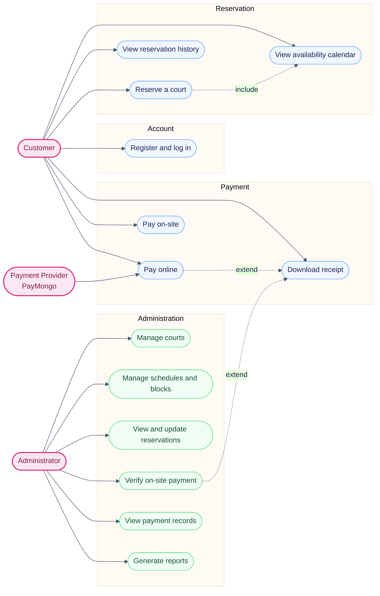
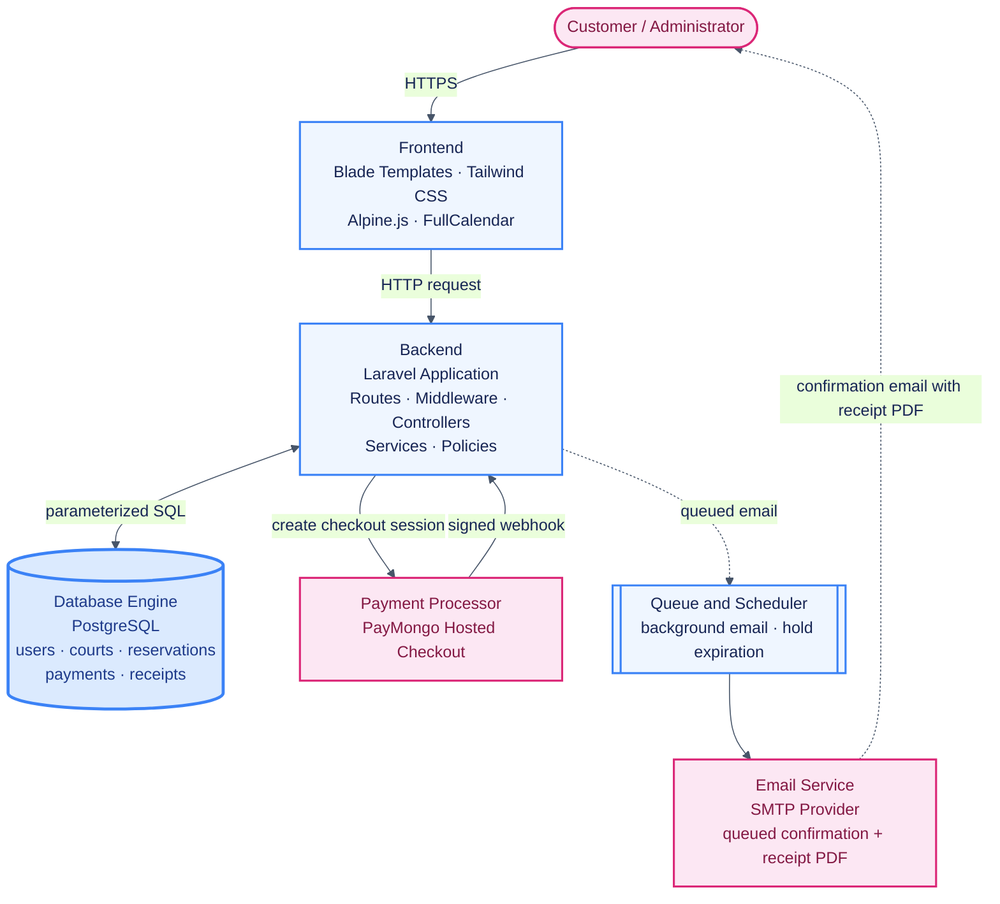
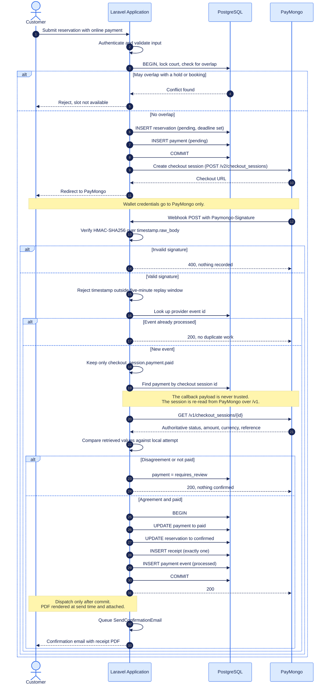
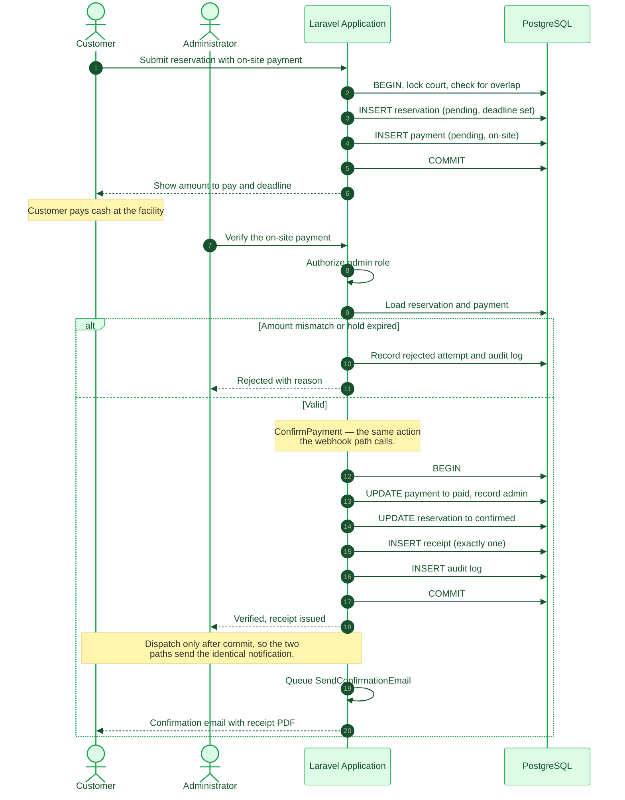

# Architecture and Use Case Diagrams

Private Pickleball Court Reservation System — Barangay San Jose, Puerto Princesa City, Palawan

Supports paper sections 2.3 (use cases), 3.2 (block diagram), and 3.3 (sequence
diagrams). Render the Mermaid source at <https://mermaid.live>.

---

## 2.3 System Use Case Diagram

### Relationships

| Relationship | Type | Description |
| --- | --- | --- |
| Reserve a court | *include* | Availability is always checked before a reservation is accepted |
| Pay online | *extend* | Adds a receipt once the payment is verified |
| Verify on-site payment | *extend* | Adds a receipt once the administrator verifies payment |

---

## 3.2 Architectural Block Diagram

---

## 3.3 Sequence Diagrams

### Online Payment and Webhook Processing

### On-site Payment Verification

---

## Notes for the paper

- Section 2.3 asks for how the actors interact with the system modules. The source
  document names three actors: Customer, Administrator, and Payment Provider.
- Section 3.2 asks for a map of the Frontend, Backend, Database Engine, Payment
  Processor, and Email Service. Those five are the main blocks.
- Section 3.3 asks for the step-by-step API communication for payment checkout and
  webhook processing, which is the first sequence diagram.
- Hold expiration, late payment reconciliation, and email retry are implemented but
  are described in text in section 4.3 rather than given separate diagrams.
- These diagrams describe the **built** system, not a target design. They were
  reconciled against the code after the PayMongo integration was verified
  end to end. Three things were corrected when that happened:
  - The webhook sequence omitted the independent `GET /v1/checkout_sessions/{id}`
    retrieval, jumping straight from validation to the confirmation transaction.
    That retrieval is the property the design actually depends on, because the
    callback payload is never trusted.
  - The on-site sequence omitted the queued confirmation email, which
    `PaymentVerificationController` dispatches after commit using the same
    `ConfirmPayment` action and the same notification as the webhook path.
  - The block diagram still named Mailtrap. Delivery is verified against a live
    SMTP provider, and the email now carries the rendered receipt PDF as an
    attachment rather than only linking to it.
- Regenerate the PNG exports from mermaid.live after editing this file. The paper
  embeds `architecture-block-diagram.png`, `sequence-payment-webhook.png`, and
  `sequence-onsite-payment.png`, so a stale export silently contradicts the text.
