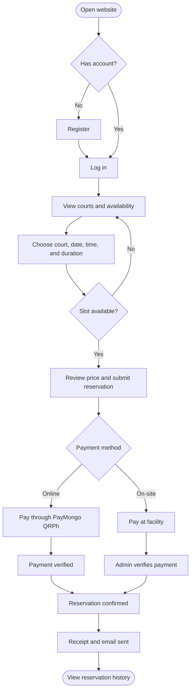
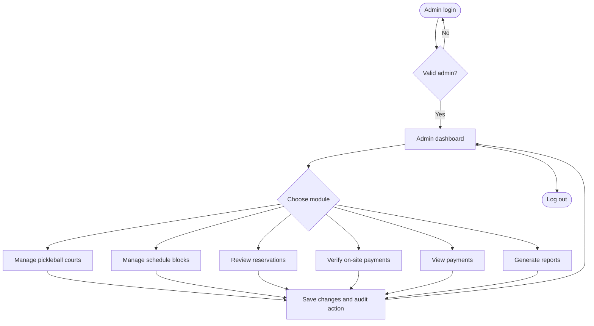
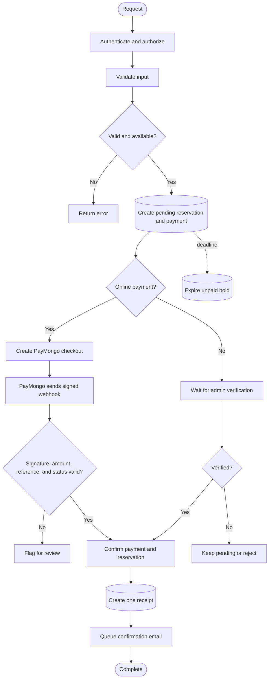

# Private Pickleball Court Reservation System — Simplified Flowcharts

These presentation diagrams keep only the decisions a user needs to explain. Detailed validation, database constraints, webhook checks, and retry behavior are documented in the technical paper.

## Customer flow

## Admin flow

## System and payment flow

## Legend

- Rounded boxes are start/end points.
- Diamond boxes are decisions.
- Database cylinders are saved records.
- Dashed arrows show the background expiration process.
