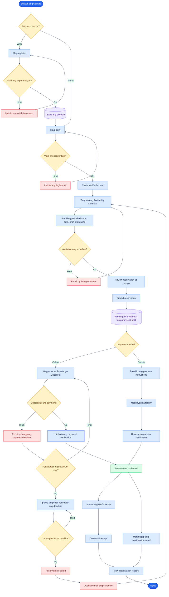
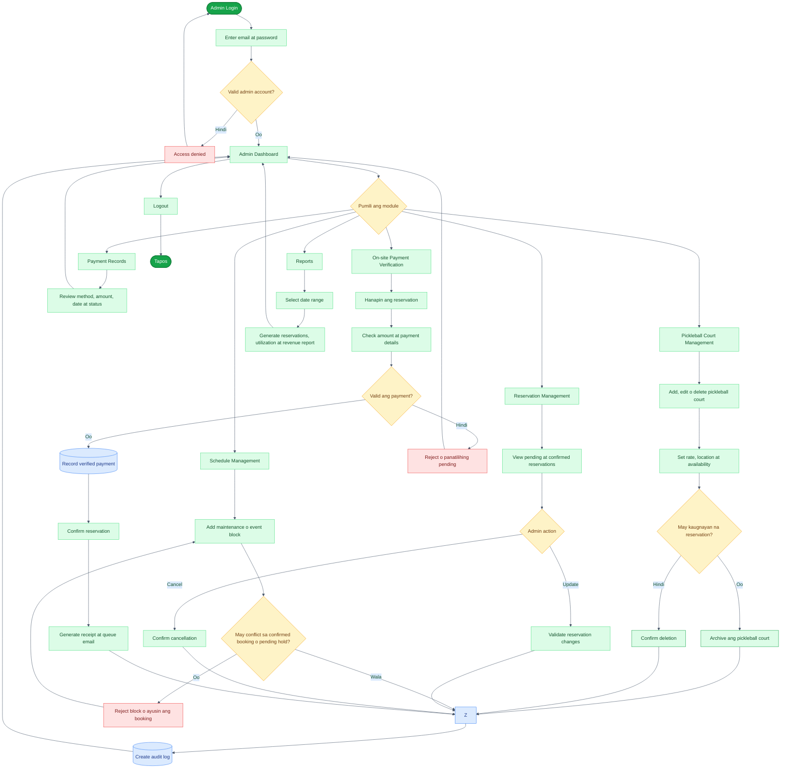

# Private Pickleball Court Reservation System Flowcharts

Legend: solid line = main flow · dotted line = background process

## Customer Flow

## Admin Flow

## Internal System Flow

```mermaid
%%{init: {"theme":"base","themeVariables":{"background":"#FAF5FF","primaryColor":"#EDE9FE","primaryTextColor":"#4C1D95","primaryBorderColor":"#7C3AED","lineColor":"#475569","secondaryColor":"#DBEAFE","tertiaryColor":"#FEF3C7","fontFamily":"Arial"}}}%%
flowchart TD
    A([Request received]) --> TLS[[HTTPS / TLS]]
    TLS --> B{Authenticated?}

    B -- Hindi --> C[Return unauthorized response]
    B -- Oo --> D{Authorized ang role?}

    D -- Hindi --> E[Return forbidden response]
    D -- Oo --> F[Validate input]

    F --> G{Valid ang data?}
    G -- Hindi --> H[Return validation errors]
    G -- Oo --> I{Anong request?}

    I -- Reservation --> J[Check court rules at operating hours]
    J --> K[Calculate start time, end time at price]
    K --> L{May overlapping reservation, hold, o court block?}

    L -- Oo --> M[Reject unavailable schedule]
    L -- Wala --> N[Start transaction, lock the court row]
    N --> O[(Create pending reservation)]
    O --> P[Set payment deadline]
    P --> Q[Commit transaction]
    Q --> R{Payment method}

    R -- Online --> S[Create PayMongo Checkout Session]
    S --> T[Return checkout URL sa customer]

    R -- On-site --> U[Return payment instructions]
    U --> V[Wait for admin verification]

    I -- CRUD operation --> W[Create, read, update o archive record]
    W --> X[(Save database changes)]
    X --> Y[(Create audit log)]
    Y --> Z[Return successful response]

    T --> AA[PayMongo sends webhook]
    AA --> AB{Valid webhook signature?}
    AB -- Hindi --> AC[Reject at log webhook]
    AB -- Oo --> AD{Processed na ang event ID?}
    AD -- Oo --> AE[Return success without duplicate changes]
    AD -- Hindi --> AF{Tama ang amount, reference at currency?}

    AF -- Hindi --> AG[Flag for manual review]
    AF -- Oo --> AH{Active pa ang reservation hold?}

    AH -- Hindi --> AG
    AH -- Oo --> AI[Start payment transaction]

    V --> AJ{Admin verified payment?}
    AJ -- Hindi --> AK[Keep pending o reject]
    AK --> AK1{Magtatapos na ba ang deadline?}
    AK1 -- Hindi --> V
    AK1 -- Oo --> AL[(Mark reservation expired)]
    AJ -- Oo --> AI

    AI --> AM[(Record payment)]
    AM --> AN[(Mark reservation confirmed)]
    AN --> AO[(Create immutable receipt)]
    AO --> AP[(Store processed payment event)]
    AP --> AQ[Commit transaction]

    AQ --> AR[Background worker sends email]
    AR --> AS{Email sent?}
    AS -- Hindi --> AT[Schedule retry]
    AT --> AR
    AS -- Oo --> AU[Mark email delivered]

    AP --> AV[Make receipt available for download]
    AU --> AW([Process completed])
    AV --> AW

    P -. scheduler tick kada minuto .-> AX[Find unpaid expired reservations]
    AX --> AY[(Mark reservations expired)]
    AY --> AZ[Release held schedules]

    classDef startEnd fill:#7C3AED,color:#FFFFFF,stroke:#6D28D9,stroke-width:2px;
    classDef process fill:#EDE9FE,color:#4C1D95,stroke:#A78BFA;
    classDef decision fill:#FEF3C7,color:#713F12,stroke:#F59E0B;
    classDef error fill:#FEE2E2,color:#7F1D1D,stroke:#EF4444;
    classDef data fill:#DBEAFE,color:#1E3A8A,stroke:#3B82F6;
    classDef success fill:#DCFCE7,color:#14532D,stroke:#22C55E;
    classDef scheduler fill:#FFEDD5,color:#7C2D12,stroke:#F97316;
    classDef security fill:#FCE7F3,color:#831843,stroke:#DB2777,stroke-width:2px;

    class A,AW startEnd;
    class F,J,K,N,P,Q,S,T,U,V,W,Z,AA,AI,AR,AV process;
    class B,D,G,I,L,R,AB,AD,AF,AH,AJ,AK1,AS decision;
    class C,E,H,M,AC,AG,AK error;
    class O,X,Y,AL,AM,AN,AO,AP,AY data;
    class AU success;
    class AX,AY,AZ scheduler;
    class TLS security;
```

## What changed and why

| Fix | Reason |
| --- | --- |
| Checkout retry limit (`U1`) | The original looped back to PayMongo forever with no limit. |
| Admin block checks pending holds | Original checked confirmed bookings only, so an admin could block a slot a paying customer was holding. |
| Delete with confirmation (`G5`-`G7`) | The instructor requires Delete with a confirmation step. Original had no delete at all. |
| Audit log after payment verification | Payment verification is security-sensitive and must be traceable. |
| On-site rejection path continues (`AK1`) | Original ended in a dead end with no way back. |
| Scheduler connected (`AX`) | Expiry runs off the payment deadline, so it is shown as triggered by it. |
| HTTPS/TLS step | Required by the security section of the paper. |

## Implementation status after the updated paper

| Paper flow | Current system behavior |
| --- | --- |
| Customer availability and booking | Implemented: operating rules, pending holds, PostgreSQL overlap protection, and customer-owned reservation history. |
| Online payment | PayMongo Hosted Checkout QRPh is the active provider flow. The signed webhook and server-side checkout verification confirm payment; browser redirects do not. |
| On-site payment | Implemented: the reservation stays pending until an administrator verifies the payment; confirmation issues the same receipt flow. |
| Admin court availability management | Implemented: court CRUD plus schedule blocks for maintenance, repairs, and private events. Blocks are checked by the same availability service used by customer bookings. |
| Receipt and email | Receipt is generated only after confirmation and is available for authorized download. Confirmation email dispatch is queued after the database transaction. |
| Expiration | Unpaid holds are expired by the scheduler and ignored by availability checks even if the scheduler is delayed. |
| Reports | Implemented: filtered reservation, court utilization, and verified-payment revenue reports. |
